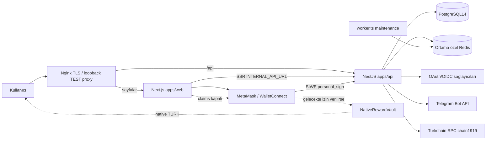
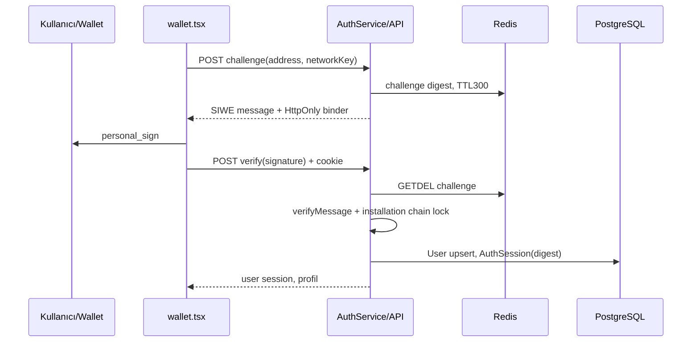
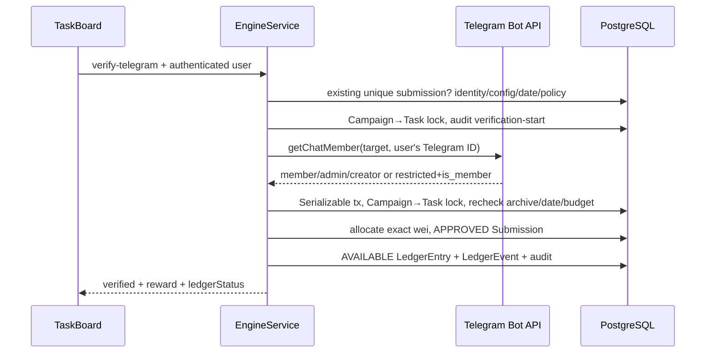
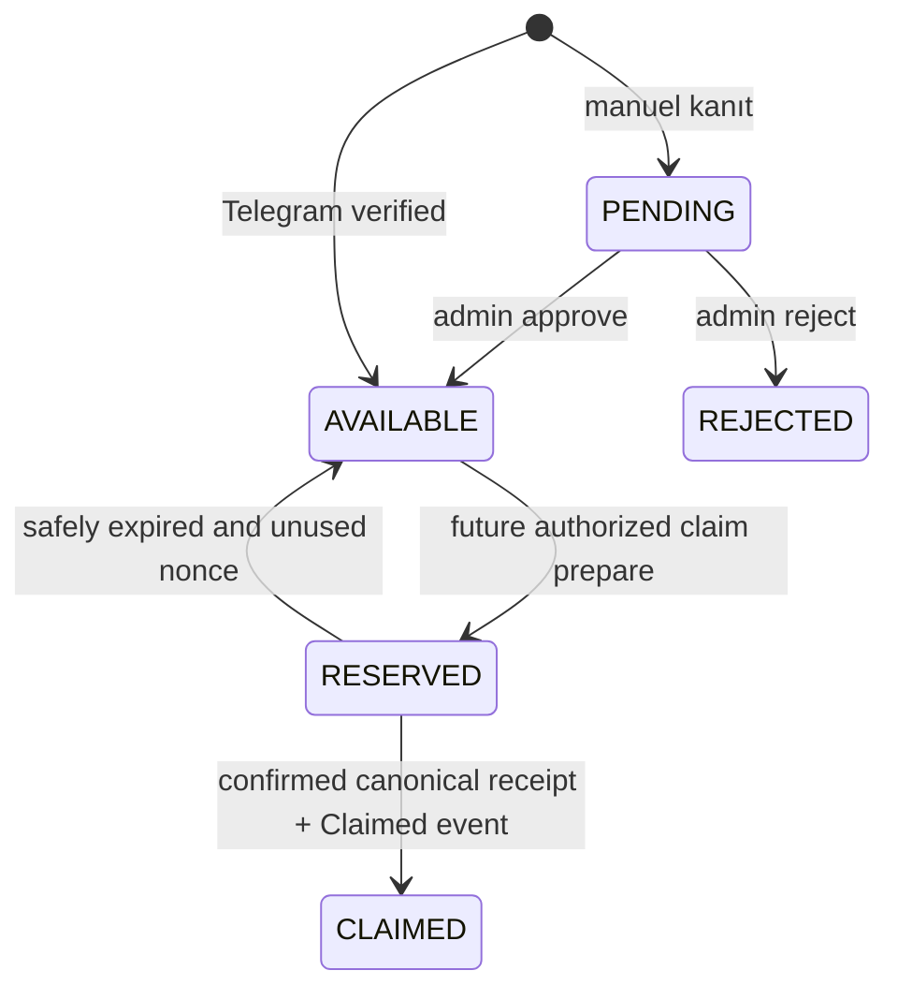
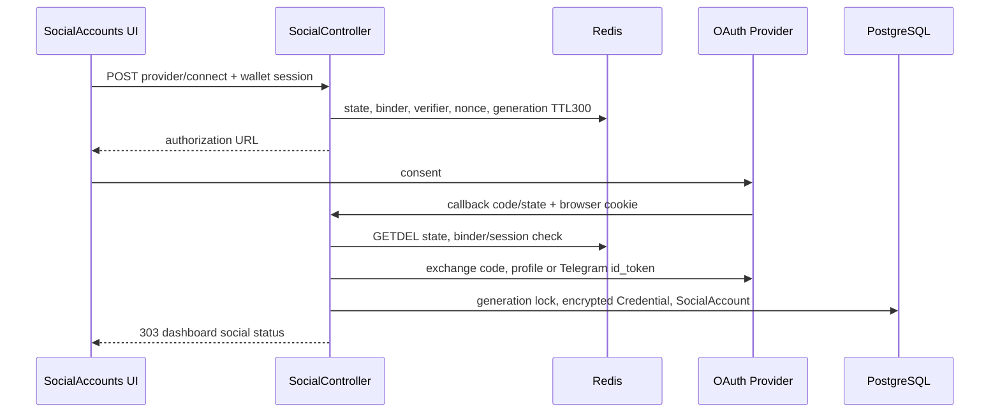
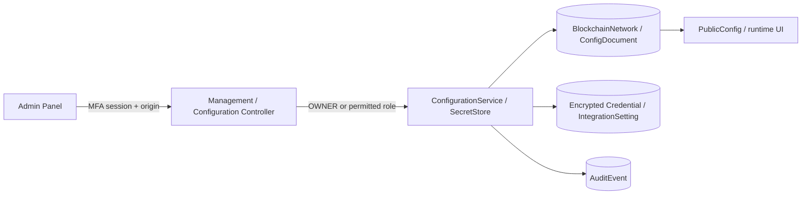

# Sistem mimarisi — Turkchain® Rewards

> **2026-11-03 güncel çalışma:** Önceki 10 TURK taslağı yerine kullanıcı 1 TURK × ilk25 kullanıcı / toplam25TURK ve TEST sonrası productionyayınını onayladı. Güncel plan ve doğrulama koşulları [REWARD25_RELEASE_READINESS](REWARD25_RELEASE_READINESS.md), tam payload [TELEGRAM_REWARD25_TASK.json](TELEGRAM_REWARD25_TASK.json), Instagram açıklaması [INSTAGRAM_READINESS](INSTAGRAM_READINESS.md). Aşağıdaki bilgiler önceki snapshot olabilir; çalışanSHA ve gerçekyayınsonucu dış PROJECT_HANDOFF.md/deploymentmanifest esas alınarak doğrulanır.

Doğrulama anı: 2026-11-02T22:34:00.042Z. Production sürümü: **0.4.5 / `cc61b966bf684ad2f602b36100c3bf1de7f4d0a7`**. Bu doküman TEST dalında hazırlanmıştır; bu çalışmada production kodu/verisi/configuration değiştirilmez. Yollar sunucu `138.226.246.138` üzerindedir. Gerçek ENV/credential değerleri açıklanmaz.

## Uygulamanın gerçek sınırları

Next.js App Router frontend (`apps/web`) ile NestJS API (`apps/api`) ayrı loopback prosesleridir. Aynı monorepo npm workspaces içerir. Veri Prisma 7/PrismaPg ile PostgreSQL14'tedir. Ayrı Redis prosesleri session challenge/OAuth state/rate-limit/BullMQ için kullanılır. Kimlik session'ı PostgreSQL AuthSession'dadır; Redis session veritabanının yerine geçmez.

Kaynakta controllers/, services/, middleware/, jobs/ veya queue/ isimli ayrı klasörler **yoktur**. Controller/service sınıfları düz `apps/api/src/*.ts` dosyalarında birlikte bulunur. Auth denetimi decorator Guard yerine controller içindeki AuthService çağrılarıyla yapılır. Next `proxy.ts` dil/path metadata taşır; Nest bootstrap middleware Helmet/no-store/trust-proxy kurar. Asıl CSRF origin ve yetki kontrolü her mutasyon yolundadır.

## Cüzdan → kullanıcı → ödül

Wallet önce runtime chain1919'u kontrol eder; MetaMask/EIP1193 veya etkinse WalletConnect ile hesap alınır. `/api/auth/challenge` adres/chain/domain/URI/nonce/5dk son kullanmalı SIWE mesajı ve HttpOnly challenge cookie üretir. Redis GETDEL ile tek kullanım tüketilir; `/verify` verifyMessage sonucu adresle eşleşirse User upsert ve digest'i DB'de tutulan 24saatlik user session cookie üretilir. Login bir native transfer işlemi değildir. Admin session 1saat ve ayrı cookie namespace kullanır.

## Sosyal bağlantı ve OAuth

`social.ts` connect wallet session ister. Platform ayarı ENV ve SecretStore/IntegrationSetting override birleşimidir. Random state, browser binder, session digest, PKCE verifier, Telegram OIDC nonce, config fingerprint ve SocialLinkState generation Redis'te 300sn saklanır. Callback state GETDEL tüketir; browser/session/role veya generation değişimi reddedilir. Provider kimliği başka kullanıcıya bağlıysa unique(provider,providerAccountId) ve servis kontrolü engeller. Tokenlar Credential içinde AES-256-GCM ile şifrelenir; APP_ENV AAD çapraz ortam çözmeyi engeller.

Telegram identity OIDC'dir; bot token kullanıcı login parolası değildir. Resmî GROUP/CHANNEL bağlantısı ise getMe→getChat→bot getChatMember ile admin erişimi doğrular. Kişisel OAuth bağlantısı ile resmî hedef hesabı iki ayrı modeldir.

## Telegram üyeliği → ledger

Telegram API çağrısı uzun DB transaction içinde tutulmaz. Harici çağrı sonrası kullanılabilirlik yeniden kontrol edilir. Nonmember ve provider hatası ödül yazmaz. Başlatılmış/başarısız Telegram doğrulama audit geçmişi kalıcı görev silmeyi engeller. Bir kullanıcı/görev için Submission unique; ledger idempotencyKey `submission:userId:taskId`, unique submissionId; bütçe exact bigint/Decimal(78,0) ile transaction içinde ayrılır. Tekrarlanabilir görev etkin değildir. Manuel eğitim kanıtı PENDING ledger oluşturur; REVIEWER/ADMIN/OWNER onayı AVAILABLE yapar, ret ayrılan bütçeyi azaltır.

## Ledger → claim → kontrat (mevcut durumda kapalı)

`ClaimService.ready` MASTER_PAYOUTS_AUTHORIZED, env REWARD_CLAIMS_PAUSED=false, runtime claimsPaused=false ve network claimEnabled koşullarının tamamını ister. Mevcut env/runtime/network pause açıktır. Admin runtime schema sadece multiChainEnabled=false/claimsPaused=true kabul eder; UI'den gerçek ödeme açma özelliği sunulmaz. Rewards vault/signer/bytecode hash konfigürasyonda boş; bu proje için doğrulanmış deployed/funded claim kontratı olduğu ileri sürülemez.

Hazır mekanizma: backend RPC bytecode hash/signer/domain/balance kontrolü sonrası EIP712 authorization üretir; AVAILABLE kayıtları RESERVED yapar. Cüzdan native kontrat claim transaction'ını kendisi gönderir. Backend receipt from/to/amount/nonce/event/bytecode/blockhash/confirmation doğrulamadan CLAIMED yapmaz. Worker'da otomatik claim/payout job yoktur; refresh/expire kullanıcı endpointleridir. Native transfer bu çalışmada yapılmaz.

## Admin → konfigürasyon, görev ve audit

`AdminPage` parola+zorunlu TOTP ve session yönetir. `ManagementController.manage` OWNER/ADMIN, review uçları OWNER/ADMIN/REVIEWER, configuration ve secrets OWNER ister. Hassas secrets/GIF için step-up; ağ activate için fresh TOTP ayrıca kontrol edilir. Task/campaign mutasyonları origin+MFA+role kontrolündedir.

Delete öncesi impact yalnız önizlemedir; kalıcı işlem transaction içinde yeniden sayım yapar. Kullanılmamış task silinir; submission veya verification audit varsa arşivlenir. Görevli/ödüllü campaign arşivlenir, children disabled/archive olur; boş ACTIVE campaign önce PAUSED yapılır. Ledger silinmez. Campaign→Task kilit sırası ve SERIALIZABLE/P2034/P2010 40001/40P01 retry eşzamanlılığı korur. Archive restore UI bu sürümde yoktur. AuditEvent actor/action/resource/time tutar; before/after payload tutmaz.

## Dosya bağlantıları ve sınırlar

| Backend dosyası | Sorumluluk / bağlantı |
|---|---|
| `/var/www/rewards.turkscan.com/REWARDSTEST/apps/api/src/auth.ts` | AuthService + UserAuthController/AdminAuthController: SIWE challenge/session, scrypt parola, TOTP MFA, roller ve admin hesapları. security/data/configuration ile bağlı. |
| `/var/www/rewards.turkscan.com/REWARDSTEST/apps/api/src/claims.ts` | ClaimService/ClaimController; EIP-712 imza, AVAILABLE→RESERVED→CLAIMED, receipt/event/reorg/expiry denetimi; ABI burada inline. config/data/wallet/claims UI ile bağlı. |
| `/var/www/rewards.turkscan.com/REWARDSTEST/apps/api/src/config-controller.ts` | OWNER ayar endpointleri: ağ/branding/runtime/ENV template/credential ve history. ConfigurationService/SecretStore kullanır. |
| `/var/www/rewards.turkscan.com/REWARDSTEST/apps/api/src/configuration.ts` | Network/branding Zod şemaları, single-chain lock, DB konfigürasyonu, RPC/WSS/contract doğrulama ve SecretStore AES-GCM erişimi. |
| `/var/www/rewards.turkscan.com/REWARDSTEST/apps/api/src/data.ts` | PrismaPg PostgreSQL ve ioredis bağlantıları; DB/Redis/worker heartbeat health; audit yazımı. |
| `/var/www/rewards.turkscan.com/REWARDSTEST/apps/api/src/engine.ts` | Görev/kampanya yaşam döngüsü, etki/silme/arşiv, tarihler, policy, Bot API üyeliği, submission ve ledger muhasebesi, serializable kilit/retry. |
| `/var/www/rewards.turkscan.com/REWARDSTEST/apps/api/src/errors.ts` | Global SafeErrors exception filter; alan bazlı VALIDATION_ERROR, güvenli Prisma hata dönüşümü; secret/log sızıntısını sınırlama. |
| `/var/www/rewards.turkscan.com/REWARDSTEST/apps/api/src/hero-media.ts` | GIF signature/boyut/frame doğrulama ve HeroVisual byte saklama; public metadata/image ve OWNER+step-up yönetimi. |
| `/var/www/rewards.turkscan.com/REWARDSTEST/apps/api/src/integration-settings.ts` | ENV + şifreli DB sosyal credential override; API testleri, safe hata/kota durumu ve masked ayar yönetimi. |
| `/var/www/rewards.turkscan.com/REWARDSTEST/apps/api/src/main.ts` | Nest AppModule, tüm controller/service kaydı, public health/config/campaigns/integrations; Helmet/no-store/trust-proxy/loopback bootstrap. |
| `/var/www/rewards.turkscan.com/REWARDSTEST/apps/api/src/oauth-lifecycle.ts` | Refresh/revoke provider adaptörleri, kimlik/scope kontrolü, Redis NX lease/cooldown, version guard; kişisel refresh controller. |
| `/var/www/rewards.turkscan.com/REWARDSTEST/apps/api/src/official-accounts.ts` | OfficialSocialAccount CRUD/default/import/connect/disconnect, Telegram Bot API grup bağlantısı, resmi OAuth hedef seçimi; yeni Chat ID şeması burada. |
| `/var/www/rewards.turkscan.com/REWARDSTEST/apps/api/src/policy.ts` | Sadece incelenmiş FIRST_PARTY/TURKCHAIN EDUCATION ve TELEGRAM_MEMBERSHIP sosyal görevlerini açan fail-closed politika. |
| `/var/www/rewards.turkscan.com/REWARDSTEST/apps/api/src/providers.ts` | 8 OAuth provider endpoint/scope/PKCE tanımı; Telegram JWKS issuer/audience/nonce OIDC; code exchange ve provider kimlik eşleme. |
| `/var/www/rewards.turkscan.com/REWARDSTEST/apps/api/src/security.ts` | scrypt hash, AES-256-GCM, APP_ENV AAD, SHA256 digest/constant-time compare, origin, cookie ve Zod parse yardımcıları. |
| `/var/www/rewards.turkscan.com/REWARDSTEST/apps/api/src/social-config.ts` | Platform ENV alias haritası, public resmî metadata, güvenli URL/credential hazır olma çözümleme. |
| `/var/www/rewards.turkscan.com/REWARDSTEST/apps/api/src/social.ts` | Kişisel OAuth connect/callback/disconnect; browser/session/state/PKCE/generation korumaları; resmi callback de burada işlenir. |
| `/var/www/rewards.turkscan.com/REWARDSTEST/apps/api/src/telegram-verifier.ts` | Sabit api.telegram.org hedefinde getMe/getChat/getChatMember; timeout/yanıt/ID safe integer sınırı; bot-admin ve kullanıcı üyelik kontrolü. |
| `/var/www/rewards.turkscan.com/REWARDSTEST/apps/api/src/worker.ts` | Ayrı BullMQ maintenance Worker/Queue; yalnız heartbeat job scheduler (15sn), Redis worker:heartbeat TTL45sn; ödül dağıtım workerı değildir. |

Ayrıntılı endpoint/alan/ortam tabloları [API_DOCUMENTATION.md](API_DOCUMENTATION.md), [DATABASE_DOCUMENTATION.md](DATABASE_DOCUMENTATION.md) ve [DEPLOYMENT_GUIDE.md](DEPLOYMENT_GUIDE.md) içindedir.

## Sosyal OAuth callback ve Admin configuration diyagramları

