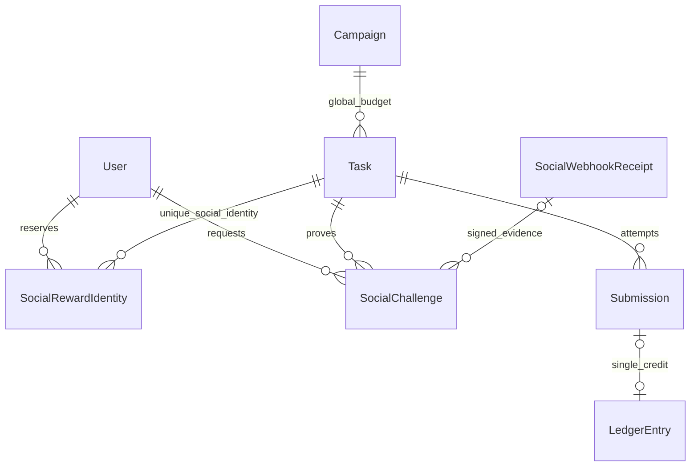
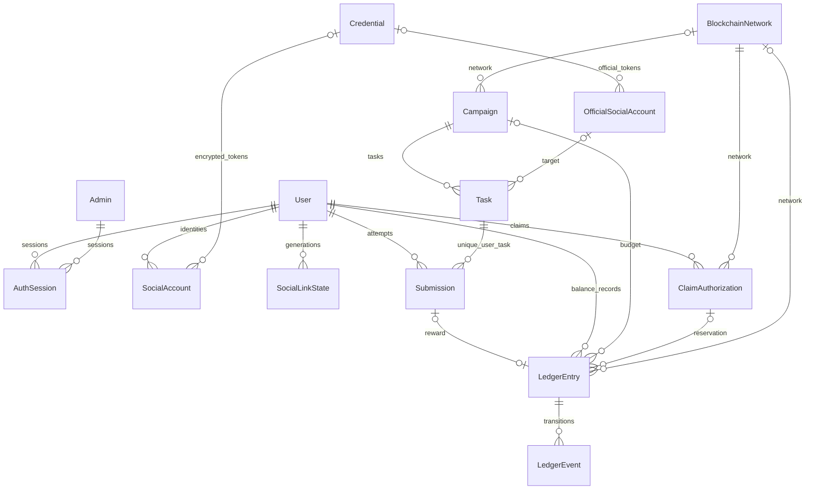

# PostgreSQL veri modeli ve migration geçmişi

## v0.5.0 güncel kapsam — 3 Kasım 2026

Kaynak dalı `feature/multi-social-rewards-engine`; önceki canlı sürüm `3c85ac1a29b51d86d74d1fe7cc847ee391f7a4c0` (v0.4.5). Aşağıdaki eski envanterler tarihsel kanıttır; güncel modüller ve sınırlar bu bölüm ile sosyal dokümanlarda açıklanır. Çalışan tam SHA, `.runtime/deployment.json` ve `.runtime/validated.json` üzerinden doğrulanır; bu dosyanın bulunduğu commit kendi hashini içermez. Yayın sonucu [PRODUCTION_RELEASE_REPORT.md](PRODUCTION_RELEASE_REPORT.md).

8 platform ve 65 görev tanımı vardır. Katalogda bulunması gerçek API bağlantısı veya ödüllü yayın izni değildir. X/YouTube teşvikli etkileşimleri politika nedeniyle kapalı; Meta/TikTok normal ticari API yetenekleri sınırlı; Kick/Twitch ödüllü etkileşimleri izin incelemesi olmadan kapalıdır. Sadece mevcut Telegram üyelik doğrulaması ve açıkça yapılandırılacak özel bot kanıtları uygulanmıştır. Hiçbir yeni canlı görev/kampanya otomatik oluşturulmaz. Tekrarlanabilir görevler reddedilir. Claim ve gerçek transferler kapalıdır.

Mevcut Telegram görevi kullanıcı başına **1 TURK**, **25 kullanıcı**, ortak kampanya **25 TURK** bütçesidir; 10 TURK eski taslaktır. Üç kampanya/dört görev korunur. `REWARD_CLAIMS_PAUSED=true`; master ödeme yetkisi tanımsızken etkin değer false olur. Telegram GROUP `-1003676977941` string olarak korunur. Gizli değerler dokümantasyona yazılmaz.

Güncel Prisma model sayısı22; `_prisma_migrations` ile23 fiziksel tablo. 15. migration `202611030001_multi_social_engine` eklemelidir. Önceki19 model aşağıdaki tarihsel ayrıntıda korunur; eski kayıt sayıları güncel sayım değildir. Canlı beklenen3 Campaign,4 Task,1 User; kesin koruma hashleri yayın raporundadır.

| Yeni alan/tablo | Veri tipi / görev |
|---|---|
| Task.socialTaskCode / targetObjectId | nullable text; katalog kodu ve sağlayıcı nesnesi |
| Task.timezone | text NOT NULL DEFAULT UTC; IANA isim, tarihler UTC |
| Task.budgetWei | nullable Decimal(78,0); eski görev null ortak bütçe, yeni katalog görevi sonlu bütçe |
| Task.allocatedWei | Decimal(78,0), default0; REJECTED dışı eski ledger üzerinden doldurulur |
| IntegrationSetting.requestedScopes | text[] default[]; resmî yönetici OAuth izinleri |
| IntegrationSetting.webhookEnabled / webhookVerifiedAt | boolean false / nullable timestamp(3); opt-in / son imza doğrulama |
| SocialRewardIdentity | taskId,userId,provider,accountHash,createdAt; task/provider/hash UNIQUE; FK RESTRICT |
| SocialWebhookReceipt | id,platform,eventId,eventType,bodyHash,actorHash?,targetObjectId?,receivedAt,occurredAt,expiresAt; platform/eventId UNIQUE |
| SocialChallenge | id,userId,taskId,officialAccountId,officialVersion,providerAccountHash,tokenHash,expiresAt,verifiedAt?,consumedAt?,receiptId?,createdAt; tokenHash UNIQUE |

Yeni tablolarda id/ilişki/özetler TEXT, officialVersion INTEGER, tarihler TIMESTAMP(3). Challenge User/Task/receipt FK RESTRICT; officialAccountId snapshot olup FK değildir, güncel version kontrolü uygulamadadır. Receipt ham provider payloadı/token saklamaz. `task_budget_bounds` CHECK allocated>=0 ve sonlu bütçe varsa allocated<=budget; kampanya ortak bütçesi de transaction içinde korunur. SQL migration mevcut ledger/user/bakiye alanlarını güncellemez. Eski sosyal ödüller için yalnız hâlâ çözülebilen kimlikler backfill edilir; bağlantısı daha önce kaldırılmış bilinmeyen tarihsel kimlik uydurulmaz.



Tam sütun, default, unique ve indekslerin otoritesi `prisma/schema.prisma` ve migration SQL'dir; yeni kaynak blokları aşağıdaki ek bölümde birebir verilmiştir.

---

## Önceki sürüm envanteri (tarihsel)


> **2026-11-03 güncel çalışma:** Önceki 10 TURK taslağı yerine kullanıcı 1 TURK × ilk25 kullanıcı / toplam25TURK ve TEST sonrası productionyayınını onayladı. Güncel plan ve doğrulama koşulları [REWARD25_RELEASE_READINESS](REWARD25_RELEASE_READINESS.md), tam payload [TELEGRAM_REWARD25_TASK.json](TELEGRAM_REWARD25_TASK.json), Instagram açıklaması [INSTAGRAM_READINESS](INSTAGRAM_READINESS.md). Aşağıdaki bilgiler önceki snapshot olabilir; çalışanSHA ve gerçekyayınsonucu dış PROJECT_HANDOFF.md/deploymentmanifest esas alınarak doğrulanır.

Doğrulama anı: 2026-11-02T22:34:00.042Z. Production sürümü: **0.4.5 / `cc61b966bf684ad2f602b36100c3bf1de7f4d0a7`**. Bu doküman TEST dalında hazırlanmıştır; bu çalışmada production kodu/verisi/configuration değiştirilmez. Yollar sunucu `138.226.246.138` üzerindedir. Gerçek ENV/credential değerleri açıklanmaz.

Kaynak: `/var/www/rewards.turkscan.com/REWARDSTEST/prisma/schema.prisma`; fiziksel envanter production PostgreSQL `information_schema`, `pg_constraint`, `pg_indexes`, `_prisma_migrations` üzerinden **READ ONLY transaction** ile çıkarıldı. Rewards DBleri PostgreSQL14/5432 üzerindedir. Aynı sunucudaki PostgreSQL16/5433 başka clusterdır; Rewards bağlantısı oraya gitmez.

| Model/tablo | İşlev | Production kayıt sayısı |
|---|---|---|
| User | SIWE cüzdan kimliği ve görüntülenen profil adı. | 1 |
| Campaign | Ağ, yayın durumu/tarihleri, exact wei bütçe ve ayrılmış ödül tutarı. | 3 |
| Task | Görev hedefi, verification JSON, rewardWei, TR/EN content/tarih/yayın/arşiv bilgisi. | 3 |
| LedgerEntry | Kullanıcının exact wei muhasebe kaydı, idempotency ve claim rezerv ilişkisi. | 0 |
| AuditEvent | İdari/görev/OAuth/claim işlem actor/action/resource/time kaydı. | 67 |
| Admin | Parola hash, role, enabled ve encrypted TOTP/replay step. | 1 |
| AuthSession | User/admin oturum token SHA256 digest alanı; MFA state ve son kullanma. | 15 |
| Submission | Kullanıcı/görev başına tek katılım ve doğrulama/inceleme sonucu. | 0 |
| LedgerEvent | Ledger durum değişimi geçmişi; aktör ve gerekçe. | 0 |
| SocialAccount | Kişisel OAuth provider kimliği/scope/credential ref; legacy encryptedTokens alanı mevcut. | 1 |
| IntegrationSetting | Sosyal provider ENV üzeri override, API bağlantı durum/version. | 2 |
| BlockchainNetwork | Tek-installation zincir konfigürasyonu JSON ve onay/aktiflik/version. | 1 |
| ConfigDocument | branding/runtime belgeleri ve version. | 2 |
| Credential | ENV dışı secret/token AES-GCM ciphertext; scope/owner/kind unique. | 2 |
| OfficialSocialAccount | Projeye ait resmî hedef hesap; kişisel kullanıcı hesabından ayrı. | 1 |
| SocialPlatform | Platform registry; yeni kayıtlar METADATA_ONLY connector olabilir. | 8 |
| SocialLinkState | Kullanıcı/provider generation; geç callback/disconnect yarışını engeller. | 1 |
| ClaimAuthorization | EIP712 authorization, recipient/amount/nonce/domain-contract/snapshot/receipt durumu. | 0 |
| HeroVisual | Homepage GIF BYTEA, boyut/hash/yayın bilgisi; DB yedeği asseti de içerir. | 1 |

## İlişkiler



AuditEvent.actor/resource serbest String alanlarıdır, kullanıcı/görev için FK değildir. ConfigDocument/IntegrationSetting JSON/override modelleri sabit tek kayıt anahtarlarını kullanır. Ayrı Notification, Balance veya Verification tablosu yoktur: bakiye LedgerEntry.status aggregate, doğrulama Submission + AuditEvent ile tutulur. Başarısız Telegram nonmember sonucu submission üretmez; audit attempt geçmişi korunur.

## Alan sözlüğü

Aşağıdaki SQL tip/default/null bilgileri gerçek production katalogundan alınmıştır. Prisma String PK `cuid()` üretimini istemci yapabilir; SQL default boş olması bu yüzden hata değildir. `—` SQL default bulunmadığını gösterir. JSON alanların iş şemaları ilgili TypeScript Zod şemasındadır. Timestamp UTC saklanır; admin formu UTC girer.

### User

SIWE cüzdan kimliği ve görüntülenen profil adı.

| Alan | PostgreSQL tipi | Nullable | SQL default |
|---|---|---|---|
| id | text | NO | — |
| wallet | text | NO | — |
| createdAt | timestamp without time zone | NO | CURRENT_TIMESTAMP |
| displayName | text | YES | — |

PK/FK/unique/check tanımları:

- `User_pkey`: `PRIMARY KEY (id)`

### Campaign

Ağ, yayın durumu/tarihleri, exact wei bütçe ve ayrılmış ödül tutarı.

| Alan | PostgreSQL tipi | Nullable | SQL default |
|---|---|---|---|
| id | text | NO | — |
| title | text | NO | — |
| description | text | NO | — |
| status | text | NO | 'DRAFT'::text |
| startsAt | timestamp without time zone | YES | — |
| endsAt | timestamp without time zone | YES | — |
| createdAt | timestamp without time zone | NO | CURRENT_TIMESTAMP |
| allocatedWei | numeric | NO | 0 |
| budgetWei | numeric | NO | 0 |
| networkId | text | YES | — |
| archivedAt | timestamp without time zone | YES | — |

PK/FK/unique/check tanımları:

- `Campaign_networkId_fkey`: `FOREIGN KEY ("networkId") REFERENCES "BlockchainNetwork"(id) ON UPDATE CASCADE ON DELETE SET NULL`
- `Campaign_pkey`: `PRIMARY KEY (id)`
- `campaign_budget_bounds`: `CHECK ((("budgetWei" >= (0)::numeric) AND ("allocatedWei" >= (0)::numeric) AND ("allocatedWei" <= "budgetWei")))`

Prisma relation alanları (fiziksel sütun değildir):

```prisma
network BlockchainNetwork? @relation(fields:[networkId],references:[id])
```

### Task

Görev hedefi, verification JSON, rewardWei, TR/EN content/tarih/yayın/arşiv bilgisi.

| Alan | PostgreSQL tipi | Nullable | SQL default |
|---|---|---|---|
| id | text | NO | — |
| campaignId | text | NO | — |
| title | text | NO | — |
| platform | text | NO | — |
| kind | text | NO | — |
| enabled | boolean | NO | false |
| rewardWei | numeric | NO | 0 |
| policyReviewed | boolean | NO | false |
| verification | jsonb | YES | — |
| targetUrl | text | YES | — |
| configurationRequired | boolean | NO | false |
| officialAccountId | text | YES | — |
| localizedContent | jsonb | YES | — |
| startsAt | timestamp without time zone | YES | — |
| endsAt | timestamp without time zone | YES | — |
| publishedAt | timestamp without time zone | YES | — |
| archivedAt | timestamp without time zone | YES | — |

PK/FK/unique/check tanımları:

- `Task_campaignId_fkey`: `FOREIGN KEY ("campaignId") REFERENCES "Campaign"(id) ON UPDATE CASCADE ON DELETE RESTRICT`
- `Task_officialAccountId_fkey`: `FOREIGN KEY ("officialAccountId") REFERENCES "OfficialSocialAccount"(id) ON UPDATE CASCADE ON DELETE SET NULL`
- `Task_pkey`: `PRIMARY KEY (id)`
- `task_reward_nonnegative`: `CHECK (("rewardWei" >= (0)::numeric))`

Prisma relation alanları (fiziksel sütun değildir):

```prisma
campaign Campaign @relation(fields:[campaignId],references:[id])
officialAccount OfficialSocialAccount? @relation(fields:[officialAccountId],references:[id])
```

### LedgerEntry

Kullanıcının exact wei muhasebe kaydı, idempotency ve claim rezerv ilişkisi.

| Alan | PostgreSQL tipi | Nullable | SQL default |
|---|---|---|---|
| id | text | NO | — |
| userId | text | NO | — |
| amountWei | numeric | NO | — |
| idempotencyKey | text | NO | — |
| reason | text | NO | — |
| createdAt | timestamp without time zone | NO | CURRENT_TIMESTAMP |
| campaignId | text | YES | — |
| status | USER-DEFINED / LedgerStatus | NO | 'AVAILABLE'::"LedgerStatus" |
| submissionId | text | YES | — |
| networkId | text | YES | — |
| claimId | text | YES | — |

PK/FK/unique/check tanımları:

- `LedgerEntry_campaignId_fkey`: `FOREIGN KEY ("campaignId") REFERENCES "Campaign"(id) ON UPDATE CASCADE ON DELETE SET NULL`
- `LedgerEntry_claimId_fkey`: `FOREIGN KEY ("claimId") REFERENCES "ClaimAuthorization"(id) ON UPDATE CASCADE ON DELETE SET NULL`
- `LedgerEntry_networkId_fkey`: `FOREIGN KEY ("networkId") REFERENCES "BlockchainNetwork"(id) ON UPDATE CASCADE ON DELETE SET NULL`
- `LedgerEntry_pkey`: `PRIMARY KEY (id)`
- `LedgerEntry_submissionId_fkey`: `FOREIGN KEY ("submissionId") REFERENCES "Submission"(id) ON UPDATE CASCADE ON DELETE SET NULL`
- `LedgerEntry_userId_fkey`: `FOREIGN KEY ("userId") REFERENCES "User"(id) ON UPDATE CASCADE ON DELETE RESTRICT`
- `ledger_reward_positive`: `CHECK (("amountWei" > (0)::numeric))`

Prisma relation alanları (fiziksel sütun değildir):

```prisma
user User @relation(fields:[userId],references:[id])
network BlockchainNetwork? @relation(fields:[networkId],references:[id])
campaign Campaign? @relation(fields:[campaignId],references:[id])
submission Submission? @relation(fields:[submissionId],references:[id])
claim ClaimAuthorization? @relation(fields:[claimId],references:[id])
```

### AuditEvent

İdari/görev/OAuth/claim işlem actor/action/resource/time kaydı.

| Alan | PostgreSQL tipi | Nullable | SQL default |
|---|---|---|---|
| id | text | NO | — |
| actor | text | NO | — |
| action | text | NO | — |
| resource | text | NO | — |
| createdAt | timestamp without time zone | NO | CURRENT_TIMESTAMP |

PK/FK/unique/check tanımları:

- `AuditEvent_pkey`: `PRIMARY KEY (id)`

### Admin

Parola hash, role, enabled ve encrypted TOTP/replay step.

| Alan | PostgreSQL tipi | Nullable | SQL default |
|---|---|---|---|
| id | text | NO | — |
| email | text | NO | — |
| passwordHash | text | NO | — |
| role | USER-DEFINED / AdminRole | NO | 'REVIEWER'::"AdminRole" |
| enabled | boolean | NO | true |
| totpEncrypted | text | YES | — |
| lastTotpStep | integer | NO | '-1'::integer |
| createdAt | timestamp without time zone | NO | CURRENT_TIMESTAMP |

PK/FK/unique/check tanımları:

- `Admin_pkey`: `PRIMARY KEY (id)`

### AuthSession

User/admin oturum token SHA256 digest alanı; MFA state ve son kullanma.

| Alan | PostgreSQL tipi | Nullable | SQL default |
|---|---|---|---|
| id | text | NO | — |
| userId | text | YES | — |
| adminId | text | YES | — |
| mfaVerified | boolean | NO | false |
| expiresAt | timestamp without time zone | NO | — |
| createdAt | timestamp without time zone | NO | CURRENT_TIMESTAMP |

PK/FK/unique/check tanımları:

- `AuthSession_adminId_fkey`: `FOREIGN KEY ("adminId") REFERENCES "Admin"(id) ON UPDATE CASCADE ON DELETE CASCADE`
- `AuthSession_pkey`: `PRIMARY KEY (id)`
- `AuthSession_userId_fkey`: `FOREIGN KEY ("userId") REFERENCES "User"(id) ON UPDATE CASCADE ON DELETE CASCADE`

Prisma relation alanları (fiziksel sütun değildir):

```prisma
user User? @relation(fields:[userId],references:[id],onDelete:Cascade)
admin Admin? @relation(fields:[adminId],references:[id],onDelete:Cascade)
```

### Submission

Kullanıcı/görev başına tek katılım ve doğrulama/inceleme sonucu.

| Alan | PostgreSQL tipi | Nullable | SQL default |
|---|---|---|---|
| id | text | NO | — |
| userId | text | NO | — |
| taskId | text | NO | — |
| proof | text | NO | — |
| status | USER-DEFINED / SubmissionStatus | NO | 'PENDING'::"SubmissionStatus" |
| reviewNote | text | YES | — |
| reviewedAt | timestamp without time zone | YES | — |
| createdAt | timestamp without time zone | NO | CURRENT_TIMESTAMP |

PK/FK/unique/check tanımları:

- `Submission_pkey`: `PRIMARY KEY (id)`
- `Submission_taskId_fkey`: `FOREIGN KEY ("taskId") REFERENCES "Task"(id) ON UPDATE CASCADE ON DELETE RESTRICT`
- `Submission_userId_fkey`: `FOREIGN KEY ("userId") REFERENCES "User"(id) ON UPDATE CASCADE ON DELETE RESTRICT`

Prisma relation alanları (fiziksel sütun değildir):

```prisma
user User @relation(fields:[userId],references:[id])
task Task @relation(fields:[taskId],references:[id])
```

### LedgerEvent

Ledger durum değişimi geçmişi; aktör ve gerekçe.

| Alan | PostgreSQL tipi | Nullable | SQL default |
|---|---|---|---|
| id | text | NO | — |
| ledgerId | text | NO | — |
| fromStatus | USER-DEFINED / LedgerStatus | YES | — |
| toStatus | USER-DEFINED / LedgerStatus | NO | — |
| actor | text | NO | — |
| reason | text | NO | — |
| createdAt | timestamp without time zone | NO | CURRENT_TIMESTAMP |

PK/FK/unique/check tanımları:

- `LedgerEvent_ledgerId_fkey`: `FOREIGN KEY ("ledgerId") REFERENCES "LedgerEntry"(id) ON UPDATE CASCADE ON DELETE RESTRICT`
- `LedgerEvent_pkey`: `PRIMARY KEY (id)`

Prisma relation alanları (fiziksel sütun değildir):

```prisma
ledger LedgerEntry @relation(fields:[ledgerId],references:[id])
```

### SocialAccount

Kişisel OAuth provider kimliği/scope/credential ref; legacy encryptedTokens alanı mevcut.

| Alan | PostgreSQL tipi | Nullable | SQL default |
|---|---|---|---|
| id | text | NO | — |
| userId | text | NO | — |
| provider | text | NO | — |
| providerAccountId | text | NO | — |
| accountName | text | NO | — |
| encryptedTokens | text | YES | — |
| scopes | ARRAY / _text | YES | — |
| expiresAt | timestamp without time zone | YES | — |
| createdAt | timestamp without time zone | NO | CURRENT_TIMESTAMP |
| credentialId | text | YES | — |
| lastError | text | YES | — |
| lastRefreshAt | timestamp without time zone | YES | — |

PK/FK/unique/check tanımları:

- `SocialAccount_credentialId_fkey`: `FOREIGN KEY ("credentialId") REFERENCES "Credential"(id) ON UPDATE CASCADE ON DELETE SET NULL`
- `SocialAccount_pkey`: `PRIMARY KEY (id)`
- `SocialAccount_userId_fkey`: `FOREIGN KEY ("userId") REFERENCES "User"(id) ON UPDATE CASCADE ON DELETE CASCADE`

Prisma relation alanları (fiziksel sütun değildir):

```prisma
user User @relation(fields:[userId],references:[id],onDelete:Cascade)
credential Credential? @relation(fields:[credentialId],references:[id])
```

### IntegrationSetting

Sosyal provider ENV üzeri override, API bağlantı durum/version.

| Alan | PostgreSQL tipi | Nullable | SQL default |
|---|---|---|---|
| platform | text | NO | — |
| disabled | boolean | NO | false |
| name | text | YES | — |
| profileUrl | text | YES | — |
| accountId | text | YES | — |
| defaultTargetUrl | text | YES | — |
| version | integer | NO | 0 |
| lastTestAt | timestamp without time zone | YES | — |
| lastSuccessAt | timestamp without time zone | YES | — |
| lastTestStatus | text | YES | — |
| lastError | text | YES | — |
| updatedAt | timestamp without time zone | NO | — |
| callbackUrl | text | YES | — |
| enabledOverride | boolean | YES | — |
| graphVersion | text | YES | — |
| authMode | text | NO | 'oauth'::text |
| credentialsUpdatedAt | timestamp without time zone | YES | — |

PK/FK/unique/check tanımları:

- `IntegrationSetting_pkey`: `PRIMARY KEY (platform)`

### BlockchainNetwork

Tek-installation zincir konfigürasyonu JSON ve onay/aktiflik/version.

| Alan | PostgreSQL tipi | Nullable | SQL default |
|---|---|---|---|
| id | text | NO | — |
| networkKey | text | NO | — |
| networkName | text | NO | — |
| chainId | text | NO | — |
| config | jsonb | NO | — |
| enabled | boolean | NO | false |
| isActive | boolean | NO | false |
| version | integer | NO | 0 |
| verification | jsonb | YES | — |
| createdAt | timestamp without time zone | NO | CURRENT_TIMESTAMP |
| updatedAt | timestamp without time zone | NO | — |

PK/FK/unique/check tanımları:

- `BlockchainNetwork_pkey`: `PRIMARY KEY (id)`

### ConfigDocument

branding/runtime belgeleri ve version.

| Alan | PostgreSQL tipi | Nullable | SQL default |
|---|---|---|---|
| key | text | NO | — |
| value | jsonb | NO | — |
| version | integer | NO | 0 |
| updatedAt | timestamp without time zone | NO | — |

PK/FK/unique/check tanımları:

- `ConfigDocument_pkey`: `PRIMARY KEY (key)`

### Credential

ENV dışı secret/token AES-GCM ciphertext; scope/owner/kind unique.

| Alan | PostgreSQL tipi | Nullable | SQL default |
|---|---|---|---|
| id | text | NO | — |
| scope | text | NO | — |
| ownerId | text | NO | — |
| kind | text | NO | — |
| ciphertext | text | YES | — |
| version | integer | NO | 0 |
| revokedAt | timestamp without time zone | YES | — |
| createdAt | timestamp without time zone | NO | CURRENT_TIMESTAMP |
| updatedAt | timestamp without time zone | NO | — |

PK/FK/unique/check tanımları:

- `Credential_pkey`: `PRIMARY KEY (id)`

### OfficialSocialAccount

Projeye ait resmî hedef hesap; kişisel kullanıcı hesabından ayrı.

| Alan | PostgreSQL tipi | Nullable | SQL default |
|---|---|---|---|
| id | text | NO | — |
| platform | text | NO | — |
| accountType | text | NO | 'PROFILE'::text |
| name | text | NO | — |
| username | text | NO | ''::text |
| accountId | text | NO | ''::text |
| profileUrl | text | NO | ''::text |
| defaultTargetUrl | text | NO | ''::text |
| enabled | boolean | NO | false |
| isDefault | boolean | NO | false |
| connectionStatus | text | NO | 'UNCONFIGURED'::text |
| credentialId | text | YES | — |
| sourceKey | text | YES | — |
| lastSuccessAt | timestamp without time zone | YES | — |
| lastError | text | YES | — |
| deletedAt | timestamp without time zone | YES | — |
| createdAt | timestamp without time zone | NO | CURRENT_TIMESTAMP |
| updatedAt | timestamp without time zone | NO | — |
| metadataOverride | boolean | NO | false |
| version | integer | NO | 0 |

PK/FK/unique/check tanımları:

- `OfficialSocialAccount_credentialId_fkey`: `FOREIGN KEY ("credentialId") REFERENCES "Credential"(id) ON UPDATE CASCADE ON DELETE SET NULL`
- `OfficialSocialAccount_pkey`: `PRIMARY KEY (id)`

Prisma relation alanları (fiziksel sütun değildir):

```prisma
credential Credential? @relation(fields:[credentialId],references:[id])
```

### SocialPlatform

Platform registry; yeni kayıtlar METADATA_ONLY connector olabilir.

| Alan | PostgreSQL tipi | Nullable | SQL default |
|---|---|---|---|
| key | text | NO | — |
| name | text | NO | — |
| connector | text | NO | — |
| enabled | boolean | NO | true |
| createdAt | timestamp without time zone | NO | CURRENT_TIMESTAMP |

PK/FK/unique/check tanımları:

- `SocialPlatform_pkey`: `PRIMARY KEY (key)`

### SocialLinkState

Kullanıcı/provider generation; geç callback/disconnect yarışını engeller.

| Alan | PostgreSQL tipi | Nullable | SQL default |
|---|---|---|---|
| userId | text | NO | — |
| provider | text | NO | — |
| generation | integer | NO | 0 |

PK/FK/unique/check tanımları:

- `SocialLinkState_pkey`: `PRIMARY KEY ("userId", provider)`
- `SocialLinkState_userId_fkey`: `FOREIGN KEY ("userId") REFERENCES "User"(id) ON UPDATE CASCADE ON DELETE CASCADE`

Prisma relation alanları (fiziksel sütun değildir):

```prisma
user User @relation(fields:[userId],references:[id],onDelete:Cascade)
```

### ClaimAuthorization

EIP712 authorization, recipient/amount/nonce/domain-contract/snapshot/receipt durumu.

| Alan | PostgreSQL tipi | Nullable | SQL default |
|---|---|---|---|
| id | text | NO | — |
| userId | text | NO | — |
| networkId | text | NO | — |
| recipient | text | NO | — |
| amountWei | numeric | NO | — |
| nonce | text | NO | — |
| deadline | timestamp without time zone | NO | — |
| createdBlock | text | NO | — |
| lastScannedBlock | text | YES | — |
| contractAddress | text | NO | — |
| bytecodeHash | text | NO | — |
| authorization | jsonb | NO | — |
| status | text | NO | 'PREPARED'::text |
| transactionHash | text | YES | — |
| confirmedAt | timestamp without time zone | YES | — |
| lastError | text | YES | — |
| checkedAt | timestamp without time zone | YES | — |
| createdAt | timestamp without time zone | NO | CURRENT_TIMESTAMP |

PK/FK/unique/check tanımları:

- `ClaimAuthorization_networkId_fkey`: `FOREIGN KEY ("networkId") REFERENCES "BlockchainNetwork"(id) ON UPDATE CASCADE ON DELETE RESTRICT`
- `ClaimAuthorization_pkey`: `PRIMARY KEY (id)`
- `ClaimAuthorization_userId_fkey`: `FOREIGN KEY ("userId") REFERENCES "User"(id) ON UPDATE CASCADE ON DELETE RESTRICT`

Prisma relation alanları (fiziksel sütun değildir):

```prisma
user User @relation(fields:[userId],references:[id])
network BlockchainNetwork @relation(fields:[networkId],references:[id])
```

### HeroVisual

Homepage GIF BYTEA, boyut/hash/yayın bilgisi; DB yedeği asseti de içerir.

| Alan | PostgreSQL tipi | Nullable | SQL default |
|---|---|---|---|
| id | text | NO | 'homepage'::text |
| filename | text | NO | — |
| contentType | text | NO | 'image/gif'::text |
| bytes | bytea | NO | — |
| size | integer | NO | — |
| width | integer | NO | — |
| height | integer | NO | — |
| frameCount | integer | NO | — |
| sha256 | text | NO | — |
| published | boolean | NO | false |
| enabled | boolean | NO | false |
| updatedAt | timestamp without time zone | NO | — |

PK/FK/unique/check tanımları:

- `HeroVisual_pkey`: `PRIMARY KEY (id)`

## Fiziksel indeksler

| Tablo | İndeks | Gerçek SQL |
|---|---|---|
| Admin | Admin_email_key | `CREATE UNIQUE INDEX "Admin_email_key" ON public."Admin" USING btree (email)` |
| Admin | Admin_pkey | `CREATE UNIQUE INDEX "Admin_pkey" ON public."Admin" USING btree (id)` |
| AuditEvent | AuditEvent_pkey | `CREATE UNIQUE INDEX "AuditEvent_pkey" ON public."AuditEvent" USING btree (id)` |
| AuthSession | AuthSession_adminId_idx | `CREATE INDEX "AuthSession_adminId_idx" ON public."AuthSession" USING btree ("adminId")` |
| AuthSession | AuthSession_expiresAt_idx | `CREATE INDEX "AuthSession_expiresAt_idx" ON public."AuthSession" USING btree ("expiresAt")` |
| AuthSession | AuthSession_pkey | `CREATE UNIQUE INDEX "AuthSession_pkey" ON public."AuthSession" USING btree (id)` |
| BlockchainNetwork | BlockchainNetwork_chainId_key | `CREATE UNIQUE INDEX "BlockchainNetwork_chainId_key" ON public."BlockchainNetwork" USING btree ("chainId")` |
| BlockchainNetwork | BlockchainNetwork_networkKey_key | `CREATE UNIQUE INDEX "BlockchainNetwork_networkKey_key" ON public."BlockchainNetwork" USING btree ("networkKey")` |
| BlockchainNetwork | BlockchainNetwork_pkey | `CREATE UNIQUE INDEX "BlockchainNetwork_pkey" ON public."BlockchainNetwork" USING btree (id)` |
| BlockchainNetwork | only_one_active_network | `CREATE UNIQUE INDEX only_one_active_network ON public."BlockchainNetwork" USING btree ("isActive") WHERE ("isActive" = true)` |
| Campaign | Campaign_archivedAt_idx | `CREATE INDEX "Campaign_archivedAt_idx" ON public."Campaign" USING btree ("archivedAt")` |
| Campaign | Campaign_pkey | `CREATE UNIQUE INDEX "Campaign_pkey" ON public."Campaign" USING btree (id)` |
| ClaimAuthorization | ClaimAuthorization_networkId_status_idx | `CREATE INDEX "ClaimAuthorization_networkId_status_idx" ON public."ClaimAuthorization" USING btree ("networkId", status)` |
| ClaimAuthorization | ClaimAuthorization_nonce_key | `CREATE UNIQUE INDEX "ClaimAuthorization_nonce_key" ON public."ClaimAuthorization" USING btree (nonce)` |
| ClaimAuthorization | ClaimAuthorization_pkey | `CREATE UNIQUE INDEX "ClaimAuthorization_pkey" ON public."ClaimAuthorization" USING btree (id)` |
| ConfigDocument | ConfigDocument_pkey | `CREATE UNIQUE INDEX "ConfigDocument_pkey" ON public."ConfigDocument" USING btree (key)` |
| Credential | Credential_pkey | `CREATE UNIQUE INDEX "Credential_pkey" ON public."Credential" USING btree (id)` |
| Credential | Credential_scope_ownerId_kind_key | `CREATE UNIQUE INDEX "Credential_scope_ownerId_kind_key" ON public."Credential" USING btree (scope, "ownerId", kind)` |
| HeroVisual | HeroVisual_pkey | `CREATE UNIQUE INDEX "HeroVisual_pkey" ON public."HeroVisual" USING btree (id)` |
| IntegrationSetting | IntegrationSetting_pkey | `CREATE UNIQUE INDEX "IntegrationSetting_pkey" ON public."IntegrationSetting" USING btree (platform)` |
| LedgerEntry | LedgerEntry_idempotencyKey_key | `CREATE UNIQUE INDEX "LedgerEntry_idempotencyKey_key" ON public."LedgerEntry" USING btree ("idempotencyKey")` |
| LedgerEntry | LedgerEntry_pkey | `CREATE UNIQUE INDEX "LedgerEntry_pkey" ON public."LedgerEntry" USING btree (id)` |
| LedgerEntry | LedgerEntry_submissionId_key | `CREATE UNIQUE INDEX "LedgerEntry_submissionId_key" ON public."LedgerEntry" USING btree ("submissionId")` |
| LedgerEvent | LedgerEvent_ledgerId_idx | `CREATE INDEX "LedgerEvent_ledgerId_idx" ON public."LedgerEvent" USING btree ("ledgerId")` |
| LedgerEvent | LedgerEvent_pkey | `CREATE UNIQUE INDEX "LedgerEvent_pkey" ON public."LedgerEvent" USING btree (id)` |
| OfficialSocialAccount | OfficialSocialAccount_pkey | `CREATE UNIQUE INDEX "OfficialSocialAccount_pkey" ON public."OfficialSocialAccount" USING btree (id)` |
| OfficialSocialAccount | OfficialSocialAccount_platform_idx | `CREATE INDEX "OfficialSocialAccount_platform_idx" ON public."OfficialSocialAccount" USING btree (platform)` |
| OfficialSocialAccount | OfficialSocialAccount_sourceKey_key | `CREATE UNIQUE INDEX "OfficialSocialAccount_sourceKey_key" ON public."OfficialSocialAccount" USING btree ("sourceKey")` |
| SocialAccount | SocialAccount_pkey | `CREATE UNIQUE INDEX "SocialAccount_pkey" ON public."SocialAccount" USING btree (id)` |
| SocialAccount | SocialAccount_provider_providerAccountId_key | `CREATE UNIQUE INDEX "SocialAccount_provider_providerAccountId_key" ON public."SocialAccount" USING btree (provider, "providerAccountId")` |
| SocialAccount | SocialAccount_userId_provider_key | `CREATE UNIQUE INDEX "SocialAccount_userId_provider_key" ON public."SocialAccount" USING btree ("userId", provider)` |
| SocialLinkState | SocialLinkState_pkey | `CREATE UNIQUE INDEX "SocialLinkState_pkey" ON public."SocialLinkState" USING btree ("userId", provider)` |
| SocialPlatform | SocialPlatform_pkey | `CREATE UNIQUE INDEX "SocialPlatform_pkey" ON public."SocialPlatform" USING btree (key)` |
| Submission | Submission_pkey | `CREATE UNIQUE INDEX "Submission_pkey" ON public."Submission" USING btree (id)` |
| Submission | Submission_userId_taskId_key | `CREATE UNIQUE INDEX "Submission_userId_taskId_key" ON public."Submission" USING btree ("userId", "taskId")` |
| Task | Task_campaignId_archivedAt_idx | `CREATE INDEX "Task_campaignId_archivedAt_idx" ON public."Task" USING btree ("campaignId", "archivedAt")` |
| Task | Task_pkey | `CREATE UNIQUE INDEX "Task_pkey" ON public."Task" USING btree (id)` |
| User | User_pkey | `CREATE UNIQUE INDEX "User_pkey" ON public."User" USING btree (id)` |
| User | User_wallet_key | `CREATE UNIQUE INDEX "User_wallet_key" ON public."User" USING btree (wallet)` |

## Muhasebe invariantları ve silme sınırı

- Tutarlar Decimal(78,0) + TypeScript BigInt: TURK decimals18; 10 TURK=10000000000000000000 wei. JS Number ile tutar hesaplanmaz.
- Submission userId/taskId unique, LedgerEntry submissionId/idempotencyKey unique; aynı görev ikinci ödülü üretmez.
- Campaign.allocatedWei toplam ayrılmış commitment'tır; budgetWei fonlanmış on-chain vault bakiyesi değildir.
- Manuel PENDING→APPROVED/AVAILABLE veya REJECTED; otomatik Telegram APPROVED/AVAILABLE. Claim rezerv/receipt/expiry iş akışı ayrıdır ve kapalıdır.
- LedgerEntry ve LedgerEvent otomatik silinmez. Opsiyonel FK'lerde SET NULL bulunan ilişkilerde ilişkiyi koparma riski vardır; application impact/transaction guard atlanarak SQL delete yapılmamalıdır. Gerçek ON DELETE davranışları yukarıdaki katalog tanımlarında ayrı ayrı verilmiştir.
- AuthSession, kişisel SocialAccount/SocialLinkState gibi bazı ilişkilerde cascade vardır; bunlar ledger cascade'i anlamına gelmez. Bu çalışma yeni cascade/migration eklemez.

## Migration geçmişi

- `202610310001_foundation`: AuditEvent, Campaign, LedgerEntry, Task, User; production uygulanmış (`2026-10-31T14:53:07.494Z`). Kaynak: `/var/www/rewards.turkscan.com/REWARDSTEST/prisma/migrations/202610310001_foundation/migration.sql`.
- `202610310002_auth`: Admin, AuthSession, User; production uygulanmış (`2026-10-31T15:13:51.969Z`). Kaynak: `/var/www/rewards.turkscan.com/REWARDSTEST/prisma/migrations/202610310002_auth/migration.sql`.
- `202610310003_engine`: Campaign, LedgerEntry, LedgerEvent, Submission, Task; production uygulanmış (`2026-10-31T15:25:21.472Z`). Kaynak: `/var/www/rewards.turkscan.com/REWARDSTEST/prisma/migrations/202610310003_engine/migration.sql`.
- `202610310004_constraints`: Campaign, LedgerEntry, Task; production uygulanmış (`2026-10-31T15:25:21.501Z`). Kaynak: `/var/www/rewards.turkscan.com/REWARDSTEST/prisma/migrations/202610310004_constraints/migration.sql`.
- `202610310005_social`: SocialAccount; production uygulanmış (`2026-10-31T17:37:18.960Z`). Kaynak: `/var/www/rewards.turkscan.com/REWARDSTEST/prisma/migrations/202610310005_social/migration.sql`.
- `202610310006_integration_settings`: IntegrationSetting, Task; production uygulanmış (`2026-10-31T17:37:18.980Z`). Kaynak: `/var/www/rewards.turkscan.com/REWARDSTEST/prisma/migrations/202610310006_integration_settings/migration.sql`.
- `202610310007_network_configuration`: BlockchainNetwork, Campaign, ConfigDocument, Credential, LedgerEntry; production uygulanmış (`2026-10-31T17:37:19.036Z`). Kaynak: `/var/www/rewards.turkscan.com/REWARDSTEST/prisma/migrations/202610310007_network_configuration/migration.sql`.
- `202610310008_official_accounts`: IntegrationSetting, OfficialSocialAccount, SocialAccount, Task; production uygulanmış (`2026-10-31T17:37:19.086Z`). Kaynak: `/var/www/rewards.turkscan.com/REWARDSTEST/prisma/migrations/202610310008_official_accounts/migration.sql`.
- `202610310009_platform_registry`: OfficialSocialAccount, SocialPlatform; production uygulanmış (`2026-10-31T17:37:19.119Z`). Kaynak: `/var/www/rewards.turkscan.com/REWARDSTEST/prisma/migrations/202610310009_platform_registry/migration.sql`.
- `202610310010_oauth_link_generations`: SocialLinkState; production uygulanmış (`2026-10-31T17:37:19.158Z`). Kaynak: `/var/www/rewards.turkscan.com/REWARDSTEST/prisma/migrations/202610310010_oauth_link_generations/migration.sql`.
- `202610310011_claim_authorizations`: ClaimAuthorization, LedgerEntry; production uygulanmış (`2026-10-31T17:37:19.230Z`). Kaynak: `/var/www/rewards.turkscan.com/REWARDSTEST/prisma/migrations/202610310011_claim_authorizations/migration.sql`.
- `202610310012_social_configuration_status`: IntegrationSetting; production uygulanmış (`2026-10-31T17:37:19.260Z`). Kaynak: `/var/www/rewards.turkscan.com/REWARDSTEST/prisma/migrations/202610310012_social_configuration_status/migration.sql`.
- `202611010001_hero_visual`: HeroVisual; production uygulanmış (`2026-10-31T23:16:24.780Z`). Kaynak: `/var/www/rewards.turkscan.com/REWARDSTEST/prisma/migrations/202611010001_hero_visual/migration.sql`.
- `202611020001_task_content_lifecycle`: Campaign, Task; production uygulanmış (`2026-11-02T21:57:25.549Z`). Kaynak: `/var/www/rewards.turkscan.com/REWARDSTEST/prisma/migrations/202611020001_task_content_lifecycle/migration.sql`.

Son migration `202611020001_task_content_lifecycle` nullable content/date/archive/publication alanlarını ekler, publishedAt audit geçmişinden backfill eder. Mevcut dokümantasyon/validation çalışması **yeni migration gerektirmez** ve production migrate komutu çalıştırılmamıştır. Migration SQL kaynakları ile canlı applied listesi eşleşti; operasyon loglarında 14 migration/no diff kanıtı vardır.

## Prisma enum değerleri

- `AdminRole`: `OWNER`, `ADMIN`, `REVIEWER`.
- `LedgerStatus`: `PENDING`, `AVAILABLE`, `RESERVED`, `CLAIMED`, `REJECTED`.
- `SubmissionStatus`: `PENDING`, `APPROVED`, `REJECTED`.

## Prisma iç tablosu: _prisma_migrations

Uygulama modeli değildir; migration checksum/log/start/finish/rollback ve applied step geçmişidir. Production satır sayısı14 applied migration ile eşleşir. Bu işte tabloya yazılmadı.

| Alan | SQL tipi | Nullable | Default |
|---|---|---|---|
| id | character varying | NO | — |
| checksum | character varying | NO | — |
| finished_at | timestamp with time zone | YES | — |
| migration_name | character varying | NO | — |
| logs | text | YES | — |
| rolled_back_at | timestamp with time zone | YES | — |
| started_at | timestamp with time zone | NO | now() |
| applied_steps_count | integer | NO | 0 |

İç tablo constraintleri: `_prisma_migrations_pkey`: `PRIMARY KEY (id)`.

## v0.5.0 yeni tabloların gerçek Prisma alanları

```prisma
model SocialRewardIdentity {
 id String @id @default(cuid())
 taskId String
 task Task @relation(fields:[taskId],references:[id],onDelete:Restrict)
 userId String
 user User @relation(fields:[userId],references:[id],onDelete:Restrict)
 provider String
 accountHash String
 createdAt DateTime @default(now())
 @@unique([taskId,provider,accountHash])
 @@index([userId])
}
```

```prisma
model SocialWebhookReceipt {
 id String @id @default(cuid())
 platform String
 eventId String
 eventType String
 bodyHash String
 actorHash String?
 targetObjectId String?
 receivedAt DateTime @default(now())
 occurredAt DateTime
 expiresAt DateTime
 challenges SocialChallenge[]
 @@unique([platform,eventId])
 @@index([expiresAt])
}
```

```prisma
model SocialChallenge {
 id String @id @default(cuid())
 userId String
 user User @relation(fields:[userId],references:[id],onDelete:Restrict)
 taskId String
 task Task @relation(fields:[taskId],references:[id],onDelete:Restrict)
 officialAccountId String
 officialVersion Int
 providerAccountHash String
 tokenHash String @unique
 expiresAt DateTime
 verifiedAt DateTime?
 consumedAt DateTime?
 receiptId String?
 receipt SocialWebhookReceipt? @relation(fields:[receiptId],references:[id],onDelete:Restrict)
 createdAt DateTime @default(now())
 @@index([expiresAt])
 @@index([userId,taskId])
}
```

